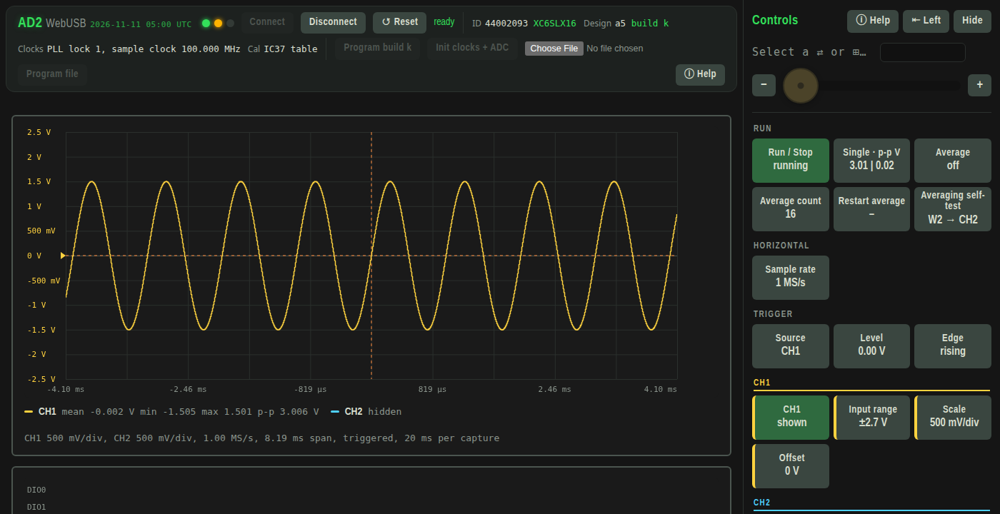
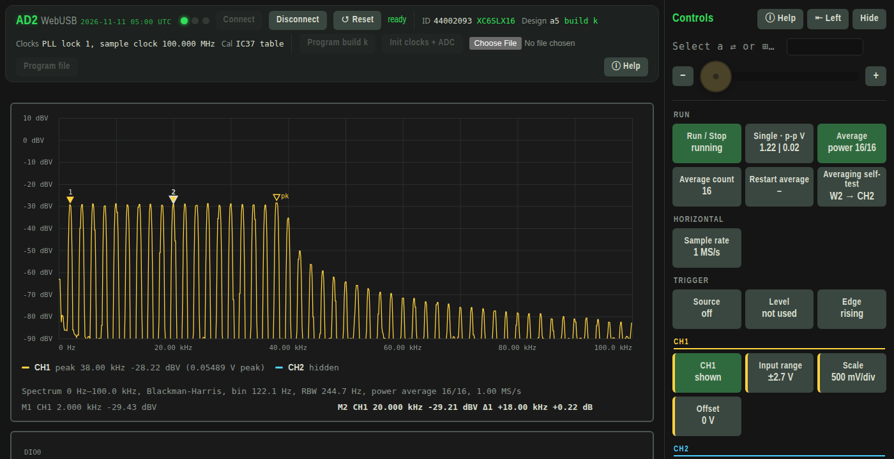
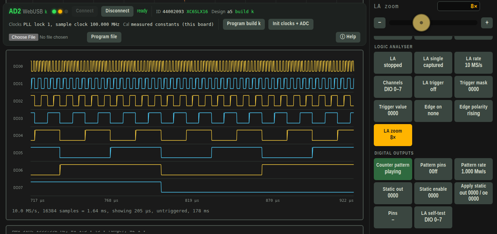

# AD2 WebUSB

A browser instrument panel for the Digilent Analog Discovery 2: oscilloscope, spectrum analyser, waveform
generator, power supplies, logic analyser and digital outputs. It runs entirely in the browser over WebUSB and
loads its own open-source FPGA design ([`hdl/`](hdl/)) into the board. No WaveForms, no Adept, no install, no server.

**It runs anywhere Chrome (or another Chromium browser such as Edge) runs: Linux, Windows, macOS, ChromeOS.**
The app itself is the same everywhere. The only platform-specific pieces are a one-time driver change on
Windows and a small helper script on Linux (see below).

This is an independent project. It is not made, supported or endorsed by Digilent. Analog Discovery is a
trademark of Digilent.

**Open the app: https://haxidermist.github.io/AD2-WebUSB/ad2.html**

## Quick start

1. Plug in the Analog Discovery 2.
   *Windows, once:* give the board the WinUSB driver, with Zadig or Device Manager (see below).
   *Linux:* download `detach.py` and run `python3 detach.py` once after plugging in (see below).
2. Open the [hosted app](https://haxidermist.github.io/AD2-WebUSB/ad2.html) in Chrome or another Chromium browser.
   It also works offline: download `ad2.html` and double-click it.
   The small date next to the name in the top bar is the page's build. If it is older than the latest entry
   in the [change log](CHANGELOG.md), your browser is showing a cached copy: reload with Ctrl+Shift+R.
3. Click **Connect** and choose "Digilent USB Device".

The page loads its FPGA design if the board is blank, initialises the clocks and converters, reads the board's
calibration from its EEPROM and shows "ready", usually within a couple of seconds.

## Requirements

- **Any operating system with a Chromium browser:** Chrome, Edge and most other Chromium browsers have WebUSB.
  Firefox and Safari do not, so the app cannot reach the board from them.
- Close WaveForms and any other tab using the board first: only one program can hold it at a time.

### Windows: WinUSB driver (once)

Windows binds the board to Digilent's FTDI driver, which the browser cannot use, so Connect either does not
list the board or cannot open it. Give it the generic WinUSB driver instead. Either way works; WebUSB on
Windows cannot use any other driver.

**With [Zadig](https://zadig.akeo.ie)** (tested):

1. Plug in the Analog Discovery 2 and run Zadig.
2. In **Options**, tick **List All Devices**.
3. Pick **Digilent USB Device** in the drop-down and check that the USB ID reads `0403 6014`.
4. Set the target driver to **WinUSB** and click **Replace Driver** (or **Install Driver**).

**Or with Device Manager**, without downloading anything (Windows 10 and 11; menu wording varies a little):

1. Plug in the board, open Device Manager and find **Digilent USB Device**.
2. Right-click it, choose **Update driver**, then **Browse my computer for drivers**, then **Let me pick from a
   list of available drivers on my computer**.
3. Choose **Universal Serial Bus devices**, then **WinUsb Device**, click **Next** and confirm the warning.

Either way, this stays in place across replugs and reboots. While the board has WinUSB, WaveForms and Adept
cannot see it.
To give it back to them, open Device Manager, find the board, choose **Uninstall device** with the option to
delete the driver ticked, and replug it (or reinstall the Adept Runtime). Zadig installs the driver for the
USB ID, so other FT232H-based gadgets with ID `0403 6014` on the same PC may pick it up too.

### Linux only: `detach.py`

On Linux, the kernel's `ftdi_sio` serial driver claims the board every time it is plugged in, and the browser
then cannot open it ("Unable to claim interface"). Run `python3 detach.py` after each plug-in to release it.
It needs only Python 3 and libusb-1.0, runs as a normal user (with the same USB access WaveForms needs), and
changes nothing permanently. Other platforms do not need it.

### Tested so far

- **Linux:** fully tested.
- **Windows:** connects once the board has the WinUSB driver (Zadig, above).
- **macOS, ChromeOS:** not tried yet. Reports are welcome.

## What it does

**A bench instrument in a browser tab.** Plug in the board, click Connect, and within a couple of seconds you
have a two-channel 100 MS/s oscilloscope, a spectrum analyser, a two-channel waveform generator, programmable
power supplies and a 16-channel logic analyser with a pattern generator. The display updates dozens of times
a second. Everything runs locally on your machine: the page talks straight to the board over USB, nothing is sent anywhere, and it keeps working offline.

**Real instrument behaviour, not a toy.** Readings use the calibration stored in your board's own EEPROM. The
scope checks its trigger on every 100 MS/s sample, on a CH1 or CH2 level, on the start of each generator
period, or on an edge of any DIO pin. It picks the hardware input range for you as you change volts per
division, and flags clipping. Averaging is aligned to the trigger, so repetitive signals clean up instead of
smearing. The spectrum view is a calibrated 8192-point FFT in dBV with a choice of windows, averaging,
max-hold and an interpolated peak marker. It runs free at full speed, or, with a trigger and Average on,
shows the spectrum of the trigger-aligned average (vector averaging): the noise floor drops by about 3 dB
per doubling of the count, which brings out small harmonics that power averaging leaves buried.

**A generator with more than the usual shapes.** Besides sine, square, triangle and sawtooth, the waveform
generator can play a band-limited sinc (a flat comb of equal harmonics, handy for a quick frequency-response
sweep) and a pseudo-random PRBS sequence (a spread-spectrum test signal). Frequency, amplitude and the phase of
W2 against W1 change live while it plays.

**Digital in and out.** The logic analyser captures all 16 DIO pins at up to 100 MS/s with a pattern-and-edge
trigger and zoom. The same pins can be driven as static outputs or play a counter pattern, which is also a
quick way to check the analyser, and any of them can trigger the oscilloscope.

**Controls built for one hand on the probe.** Every control is a tile showing its current value. Click one and
adjust it with the slider, the −/+ buttons, or by typing an exact value. Turn on help to get an explanation of
any tile on mouse-over.

The screenshots are of the app running on a real board, with W1 looped back to CH1.

### Specifications

| Instrument | Details |
|---|---|
| Oscilloscope | 2 channels, 14-bit, 10 kS/s to 100 MS/s, 8192 samples. 1 mV/div to 5 V/div with offset; the two hardware input ranges (±2.7 V and ±25 V) are picked automatically. Trigger on a CH1 or CH2 level crossing, on the start of each waveform-generator period, or on an edge of any DIO pin, with auto timeout. Trigger-aligned averaging. |
| Spectrum analyser | 8192-point FFT of both channels in dBV. Blackman-Harris, Hann, flat-top or rectangular window; live, averaged or max-hold trace; vector averaging of trigger-aligned waveforms; centre frequency and span, linear or log axis; peak marker. |
| Waveform generator | W1 and W2: sine, square, triangle, sawtooth, sinc (1 to 100 lobes) and PRBS spread-spectrum (order 3 to 12), 1 Hz to 10 MHz, amplitude to 5 V, W2 phase offset. |
| Power supplies | V+ and V− 0.5 to 5 V, on/off, USB or external power mode. Monitors show the USB and AUX input voltage and current and the board temperature. |
| Logic analyser | 16 channels (DIO 0–15, view 8 or 16), selectable rate, pattern trigger with optional edge, zoom. |
| Digital outputs | Static levels with per-pin output enable, a counter pattern on chosen pins, pin readback. |

There are also self-tests: averaging (needs W2 wired to CH2) and the logic analyser (uses DIO 0–7).

## Using the panel

All controls are tiles in the side panel, grouped like the front of a bench oscilloscope. Clicking a tile
selects it. Use the slider, the −/+ buttons, or type an exact value: SI suffixes such as `2.5k`, `10m` or
`1M` work, and bit tiles take hex. Toggle tiles switch on a click, cycle tiles step through their options.
The **ⓘ** button in the top bar shows help for each tile on mouse-over. The panel can be hidden or moved to
the other side. Settings are remembered in the browser, separately for each copy of the page (the hosted
app, a downloaded file, an Incognito window). If one copy behaves differently from another, for example
much slower, its remembered settings differ: the **↺ Reset** button next to Connect resets them to the
defaults.

## Notes and limits

- **Supply current:** on USB power the supplies have a fixed limit of roughly 1 W in total and trip above it.
  Use an external supply on the AUX input for more.
- **Inputs:** the scope inputs take ±25 V at most. The digital pins are 3.3 V logic.
- **Not yet tested on hardware:** the ±25 V range, and the scope trigger, V− and external power mode in this page.
  Treat their readings with care until checked against a known reference.
- The page replaces the FPGA design WaveForms uses. WaveForms reloads its own the next time it opens the board,
  so nothing on the board is changed permanently. The calibration EEPROM is only read, never written.
- Known artefacts: small spurs at 20 and 40 MHz in the spectrum, and some crosstalk from the waveform
  generator into the scope inputs.

## Files

| File | Purpose |
|---|---|
| `ad2.html` | The whole application: page, USB driver and FPGA design in one file. |
| `detach.py` | Linux only: releases the board from the kernel serial driver. |
| `hdl/` | Verilog source, pin map and build script of the FPGA design ([details](hdl/README.md)). |
| `CHANGELOG.md` | What changed in each update ([change log](CHANGELOG.md)). |
| `LICENSE` | MIT licence. |
